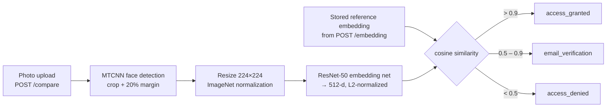
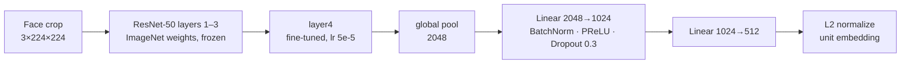
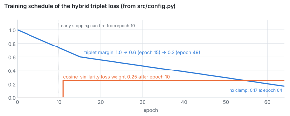

# Face Authentication Pipeline

<p>
  
  
  
  
  <a href="LICENSE"></a>
</p>

**An end-to-end face verification system: a metric-learning training pipeline and a FastAPI service that turns two photos into an access decision.** A ResNet-50 is fine-tuned to map faces to 512-dimensional unit vectors, so photos of the same person land close together. Training uses a hybrid triplet loss that mixes hard and semi-hard triplets, a scheduled margin and a late cosine-similarity term. The service detects and crops the face with MTCNN, embeds it, and compares it to a stored reference embedding. Instead of a single yes/no it returns one of three outcomes: grant, ask for email verification, or deny.

## How a verification request flows



The thresholds come from `src/config.py` (`THRESHOLD`, `EMAIL_THRESHOLD`). The middle band exists for the uncertain cases: a borderline match is not rejected outright but sent to a second factor.

## The model



Only `layer4` and the embedding head train. The head learns at `2e-4`, the backbone stage at `5e-5`, with AdamW, `ReduceLROnPlateau`, mixed precision and `torch.compile`.

### Hybrid triplet loss

Each training sample is an (anchor, positive, negative) triplet: two photos of one identity and one photo of another. Within each batch the loss keeps the triplets that still carry signal:

- **hard** triplets, where the negative is closer to the anchor than the positive (`d_an < d_ap`);
- **semi-hard** triplets, where the negative is farther but still inside the margin (`d_ap < d_an < d_ap + margin`).

The two are mixed as `α · hard + (1 − α) · semi_hard` with `α = 0.4`. The margin starts wide so early training only has to separate identities coarsely, then tightens. After epoch 10 a cosine-similarity term pulls anchor and positive embeddings together directly.

<picture>
  <source media="(prefers-color-scheme: dark)" srcset="assets/readme/schedule-dark.svg">
  
</picture>

<sub>Drawn by calling `margin_schedule()` and the loss's cosine-weight rule with the values in `src/config.py`.</sub>

## Results

From the original training run on [VGGFace2](https://www.robots.ox.ac.uk/~vgg/publications/2018/Cao18/cao18.pdf), evaluated on balanced positive/negative pairs of validation identities. The decision threshold is the one that maximizes accuracy on those pairs.

| Metric | Score |
|---|---|
| Best threshold (cosine) | 0.91 |
| Accuracy | 89% |
| Precision | 86% |
| Recall | 92% |
| F1 | 89% |
| ROC AUC | 0.95 |


<sub>t-SNE of validation embeddings from that run; each colour is one identity. The trained VGGFace2 checkpoint is not included in the repository.</sub>

## Quickstart

Requires Python ≥ 3.11. Dependencies in `requirements.txt` are pinned to a set verified end to end.

```bash
git clone https://github.com/mohamedkhayat/face-auth-pipeline.git
cd face-auth-pipeline
uv venv && source .venv/bin/activate      # or: python3 -m venv .venv
uv pip install -r requirements.txt        # or: pip install -r requirements.txt
```

On Linux the pinned `torch`/`torchvision` pull CUDA wheels. For a CPU-only machine, install the CPU builds first:

```bash
pip install torch==2.14.1 torchvision==0.29.1 --index-url https://download.pytorch.org/whl/cpu
pip install -r requirements.txt
```

### Data

One folder per identity, at least two images each. Set `DATA_DIR` to use another location (default `<repo>/data`):

```
data/
├── train/<identity>/img1.jpg ...
└── val/<identity>/img1.jpg ...
```

### Train

```bash
python src/train.py
```

- Uses the GPU when available, otherwise the CPU.
- W&B logs offline by default, so no account is needed. Run `wandb login` and set `WANDB_MODE=online` to sync.
- Hyperparameters and paths live in `src/config.py`. `EPOCHS`, `DATA_DIR`, `MODELS_DIR`, `MODEL_FILENAME` and `WANDB_MODE` can be overridden with environment variables.
- The best model is saved to `models/face_verification_resnet50.pth`. t-SNE and ROC plots go to `tsneplots/` and `ROCplots/`.

### Serve

```bash
uvicorn src.api:app --reload          # http://127.0.0.1:8000, loads models/face_verification_resnet50.pth
```

The first start downloads the MTCNN weights (~30 MB).

**`POST /embedding`**: enrol a face and get its reference embedding.

```bash
curl -X POST http://127.0.0.1:8000/embedding -F 'file=@enrol.jpg'
# {"embedding": [0.1234, -0.5678, ...]}
```

**`POST /compare`**: verify a new photo against a stored embedding.

```bash
curl -X POST http://127.0.0.1:8000/compare \
     -F 'ref_embedding=[0.1234, -0.5678, ...]' -F 'test_file=@login.jpg'
# {"similarity": 0.93, "result": "access_granted"}
```

## Next step

Liveness detection, so a printed photo or a screen replay cannot pass as a live face.

## Acknowledgments

Trained on [VGGFace2](https://www.robots.ox.ac.uk/~vgg/publications/2018/Cao18/cao18.pdf) (Cao et al., 2018) from the Visual Geometry Group, University of Oxford: 3.31 million images of 9,131 subjects with wide variation in pose, age, illumination, ethnicity and profession.
